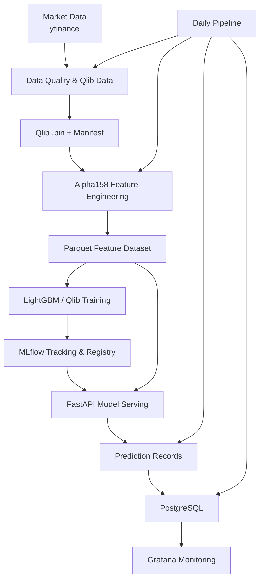

本项目是 MLOps 工程能力练习，量化仅作为载体，不涉及策略研究或交易
# Quant Qlib MLOps

**An end-to-end MLOps engineering project for quantitative machine learning.**

基于 Microsoft Qlib 构建的量化机器学习 MLOps 工程实践项目，围绕美股日频数据，打通数据处理、特征工程、模型训练、实验追踪、模型注册、在线推理、模型监控及 CI/CD 镜像发布流程。

项目重点不是开发交易策略，而是探索如何将机器学习模型从研究代码转化为可重复运行、可监控、可维护的工程系统。

## 1. Project Overview

本项目实现了一套端到端的 MLOps 工作流：

- **Data Engineering**：基于 yfinance 获取美股日频数据，完成数据清洗、质量检查、Qlib 数据转换及数据版本记录。
- **Feature Engineering**：使用 Qlib Alpha158 生成特征，并以 Parquet 文件作为离线特征数据载体。
- **Model Training**：基于 Qlib + LightGBM 完成模型训练、Walk-forward 验证和回测。
- **Experiment Tracking**：使用 MLflow Tracking 记录实验参数、指标及模型产物。
- **Model Registry**：通过 MLflow Model Registry 管理模型版本和别名。
- **Model Serving**：使用 FastAPI 提供按日期批量预测接口。
- **Monitoring**：使用 PostgreSQL 存储预测表现、IC/Rank IC 和 PSI 等指标，通过 Grafana 展示模型健康状态。
- **CI/CD**：使用 GitHub Actions 完成代码质量检查、Docker 镜像构建及 GHCR 发布。

## 2. Architecture



系统采用离线特征计算与在线推理解耦的设计：

1. 数据处理和特征工程在本地批处理环境中完成。
2. 生成的 Parquet 特征文件供模型服务读取。
3. FastAPI 加载已注册模型，对指定交易日的股票截面进行批量预测。
4. 预测结果及后续实际表现写入 PostgreSQL。
5. 独立监控脚本计算模型表现和特征漂移指标，由 Grafana 展示。

详细架构及技术决策见 [architecture.md](architecture.md)。

## 3. Key Engineering Capabilities

### Data Pipeline

- yfinance 日频行情数据采集与增量更新。
- OHLCV 数据质量检查和异常数据过滤。
- Qlib `.bin` 数据集生成与更新。
- `manifest.json` 记录数据版本和数据血缘信息。
- Lineage run records 和数据新鲜度报告。

### Model Lifecycle

- Qlib Alpha158 特征工程。
- LightGBM 模型训练。
- 多窗口 Walk-forward 验证。
- MLflow 实验追踪和模型注册。
- 模型别名管理及 FastAPI 推理服务。

### Monitoring & Observability

- 预测结果记录及实际收益回填。
- 滚动 IC / Rank IC 监控。
- 特征 PSI 漂移监控。
- PostgreSQL 指标存储。
- Grafana 可视化和 Webhook 告警。

### Containerization & CI/CD

- Docker 多阶段构建。
- Docker Compose 管理本地服务组件。
- GitHub Actions 自动执行依赖锁定检查、Ruff 静态检查和 Python 编译检查。
- Docker 镜像发布至 GitHub Container Registry（GHCR）。
- 基于镜像构建输入文件的路径过滤，避免纯数据和文档更新触发不必要的镜像构建。

## 4. Technology Stack

| Category | Technologies |
|---|---|
| Language | Python 3.11, Bash |
| ML Framework | Microsoft Qlib, LightGBM |
| Feature Engineering | Alpha158, Pandas, Parquet |
| Experiment Tracking | MLflow |
| API Serving | FastAPI |
| Database | PostgreSQL, SQLite |
| Monitoring | Grafana |
| Containerization | Docker, Docker Compose |
| CI/CD | GitHub Actions |
| Image Registry | GitHub Container Registry |
| Dependency Management | uv |
| Data Source | yfinance |
| Development Environment | Ubuntu on WSL2 |

## 5. Repository Structure

```text
quant_qlib_mlops/
├── .github/
│   └── workflows/          # CI and Docker image publishing
├── app/                    # FastAPI inference service
├── configs/                # Qlib training and workflow configs
├── data/                   # Market data, Qlib data, features and lineage
├── docs/                   # Operational documentation
├── monitoring/             # Grafana dashboards and provisioning
├── scripts/                # Data, training, prediction and monitoring jobs
├── src/                    # Shared project modules
├── Dockerfile              # Multi-stage API image build
├── docker-compose.yml      # Local service stack
├── docker-compose.prod.yml # Production-oriented Compose configuration
├── architecture.md         # Detailed architecture and engineering decisions
├── pyproject.toml
└── uv.lock
```

## 6. Running the Project

项目的主要开发与批处理环境为 Ubuntu on WSL2。

主要执行入口：

- 日常数据更新与监控：`scripts/m5_run_daily_pipeline.sh`
- 特征生成：`scripts/m4_generate_features.py`
- 模型训练：`scripts/m2_run_walkforward.py`
- 模型注册：`scripts/m3_register_model.py`
- API 服务：`app/main.py`

Docker Compose 用于启动本地 API、PostgreSQL、Grafana 和 Adminer 等服务组件。

具体环境配置、启动顺序和故障排查请参考 [docs/Runbook.md](docs/Runbook.md)。

## 7. CI/CD Workflow

项目包含两条 GitHub Actions 工作流：

**CI (`ci.yml`)**

- 检查 uv lock 文件一致性。
- 执行 Ruff 静态代码检查。
- 执行 Python 文件编译检查。

**Docker Image Publish (`docker-publish.yml`)**

- 在符合镜像构建输入条件的代码推送时构建镜像。
- 支持 `v*` 版本标签发布。
- 支持手动触发。
- 将镜像推送至 GHCR。

镜像仓库：

`ghcr.io/zhanghaifeng9988/quant_qlib_mlops`

当前项目已完成镜像构建与发布配置，但尚未实现 EC2 自动部署。

## 8. Engineering Scope & Limitations

本项目定位为个人 MLOps 工程实践项目，不是实际运行的量化交易生产系统。

当前边界：

- 数据采集依赖 yfinance，数据更新由本地批处理流程执行。
- 当前股票池采用静态成分股快照，尚未实现完整的 Point-in-Time Universe。
- 模型训练与回测用于工程链路验证，不代表策略具有稳定的实盘盈利能力。
- 当前未接入真实交易账户或自动交易执行系统。
- Docker 镜像发布已实现，AWS EC2 自动部署尚未实现。
- Kubernetes 不属于当前实施范围。

这些限制是当前项目的明确工程边界，而不是已经完成的生产能力。

## 9. Project Status

**Current version: v0.1.1**

当前版本已完成：

- 数据处理与质量检查流程。
- Qlib 数据底座及数据血缘记录。
- 模型训练、Walk-forward 评估与 MLflow 追踪。
- 模型注册与 FastAPI 推理。
- PostgreSQL + Grafana 监控体系。
- 本地日更批处理链路。
- Docker 容器化及 Compose 服务配置。
- GitHub Actions CI 和 GHCR 镜像发布。

项目当前重点是总结和展示已完成的 MLOps 工程实践，不再以增加功能为目标。

---

**Repository:** [quant_qlib_mlops](https://github.com/zhanghaifeng9988/quant_qlib_mlops)

**Architecture:** [architecture.md](architecture.md)
**Operations:** [docs/Runbook.md](docs/Runbook.md)